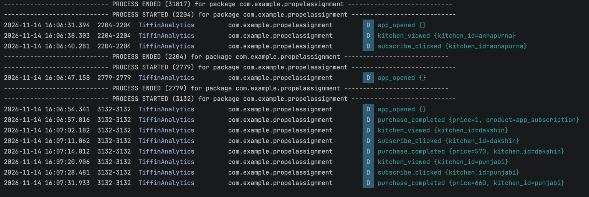

# Dabba Service

An Android prototype for discovering local home kitchens, reviewing their weekly tiffin menus, and simulating a subscription purchase. It is built as a single-module Kotlin and Jetpack Compose application.

## What I cut and why

- **Real payment processing and a backend:** intentionally out of scope. Purchases are simulated and kept on-device so the core subscription journey can be completed and reviewed reliably.
- **Remote data and image APIs:** intentionally omitted. Kitchen and breakfast data are bundled JSON assets, keeping the prototype deterministic and usable offline.
- **Instrumentation test suite:** not completed in the time available. I prioritised durable launch, purchase, booking, and meal-customisation state instead. The manual test checklist below is the follow-up.
- **Production authentication, account recovery, and server-side entitlement validation:** not appropriate without a backend.

## Implemented

- Kitchen discovery list with loading, empty, error, and retry states.
- Twelve bundled kitchens with cuisine, price, dietary type, rating, and Monday-Sunday menus.
- Kitchen detail, breakfast/lunch/dinner cards, dietary indicators, and meal customisation.
- Independent kitchen plan selections, subscriptions, credits, bookings, and meal preferences. A change in Kitchen A does not affect Kitchen B.
- A reusable charge-list paywall:
  - on a first kitchen-plan purchase: selected kitchen plan plus a one-time ₹1 app subscription;
  - on the third genuine app launch, for an unpaid user: only the ₹1 app subscription;
  - after the app subscription: only the selected kitchen plan.
- Persistent state using `SharedPreferences`, with synchronous writes for launch count, app membership, kitchen plans, bookings, and meal preferences.
- Logcat analytics through a replaceable interface: `app_opened`, `kitchen_viewed`, `subscribe_clicked`, and `purchase_completed`.

## Project structure

```text
app/src/main/
├── assets/                 # kitchens.json and breakfasts.json
├── java/.../
│   ├── analytics/          # Analytics interface and Logcat implementation
│   ├── data/               # Kitchen models and local repository
│   ├── persistence/        # Durable app and kitchen-scoped state
│   └── ui/                 # ViewModel, composable screens, theme
└── res/                    # Compose resources, font, and meal images
```

## Build and run

1. Open the project in Android Studio.
2. Install/select a JDK compatible with the project (Java 11 or newer) and Android SDK 37.
3. Run the `app` configuration on an API 24+ emulator or device.

Command-line build:

```bash
./gradlew :app:assembleDebug
```

The current development machine did not have a Java Runtime available, so I could not complete a local Gradle build verification here.

## Dependencies

Dependencies are deliberately limited to the standard AndroidX Compose stack; no payment, networking, image-loading, JSON, or analytics SDK was added.

| Dependency | Purpose | Version source |
| --- | --- | --- |
| Android Gradle Plugin | Android build | `9.4.1` |
| Kotlin Compose plugin | Kotlin and Compose compiler integration | `2.2.10` |
| AndroidX Compose BOM | Aligns Compose library versions | `2026.02.01` |
| `androidx.activity:activity-compose` | Compose activity host | `1.8.0` |
| `androidx.compose.material3:material3` | Material 3 composables | Compose BOM |
| `androidx.compose.ui:ui` | Compose UI runtime | Compose BOM |
| `androidx.compose.ui:ui-graphics` | Canvas dietary indicator drawing | Compose BOM |
| `androidx.compose.ui:ui-tooling-preview` | Preview support | Compose BOM |
| `androidx.core:core-ktx` | Android Kotlin extensions | `1.10.1` |
| `androidx.lifecycle:lifecycle-runtime-ktx` | Lifecycle support | `2.6.1` |
| `androidx.lifecycle:lifecycle-viewmodel-ktx` | ViewModel and `viewModelScope` | `2.6.1` |

Test-only dependencies: JUnit 4.13.2, AndroidX JUnit 1.1.5, Espresso 3.5.1, and Compose UI test libraries via the Compose BOM.

## Task 2 - Fix what the agent wrote

### Problems in the supplied snippet

1. **Secret key embedded in the client:** `sk_live_...` can be extracted from the APK and abused, which could create direct financial exposure.
2. **Network work in a composable effect:** `URL.readText()` is blocking and can run on the main thread. This can freeze the screen or throw `NetworkOnMainThreadException` - the most likely reason for a one-star review.
3. **UI state is not observable:** a plain `mutableListOf` does not notify Compose after `addAll`, so the list may remain empty.
4. **The effect has an unstable key:** `items` is recreated on every composition, so Compose treats it as a new key and can launch the effect again.
5. **Rotation and recomposition can create duplicate billable calls:** screen rotation, navigation, or any recomposition can repeat the request. Together with the hardcoded live API key, ordinary interaction can hit a billable endpoint many times and create unexpectedly large charges.

### Corrected version

The app should use a repository and ViewModel. For this assignment, the repository reads the local asset off the main thread; no API key or network call is needed.

```kotlin
sealed interface KitchenLoadState {
    data object Loading : KitchenLoadState
    data class Content(val kitchens: List<Kitchen>) : KitchenLoadState
    data object Empty : KitchenLoadState
    data object Error : KitchenLoadState
}

class KitchenViewModel(private val repository: KitchenRepository) : ViewModel() {
    private val _state = MutableStateFlow<KitchenLoadState>(KitchenLoadState.Loading)
    val state: StateFlow<KitchenLoadState> = _state.asStateFlow()

    init { loadKitchens() }

    fun loadKitchens() = viewModelScope.launch(Dispatchers.IO) {
        _state.value = KitchenLoadState.Loading
        _state.value = runCatching { repository.loadKitchens() }.fold(
            onSuccess = { kitchens ->
                if (kitchens.isEmpty()) KitchenLoadState.Empty
                else KitchenLoadState.Content(kitchens)
            },
            onFailure = { KitchenLoadState.Error }
        )
    }
}

@Composable
fun KitchenList(viewModel: KitchenViewModel, onKitchenSelected: (Kitchen) -> Unit) {
    when (val state by viewModel.state.collectAsState()) {
        KitchenLoadState.Loading -> CircularProgressIndicator()
        KitchenLoadState.Empty -> Text("No kitchens are available yet.")
        KitchenLoadState.Error -> Button(onClick = viewModel::loadKitchens) { Text("Try again") }
        is KitchenLoadState.Content -> LazyColumn {
            items(state.kitchens, key = { it.id }) { kitchen ->
                KitchenRow(kitchen, onClick = { onKitchenSelected(kitchen) })
            }
        }
    }
}
```

## Task 3 - Release note

### Dabba Service v1.0.0 - proposed release note

Dabba Service is ready for a small internal release on Android API 24 and above. Before publishing, I would manually test the kitchen list, detail, paywall, and post-purchase journey on one small phone (API 24/26), a current Pixel-class device (API 35+), and a tablet or large emulator. I would explicitly test rotation, force-stop/relaunch, the third-launch paywall, a first ₹1 app subscription, kitchen-plan purchase, a second kitchen purchase, booking a dabba, and kitchen-scoped meal modifications.

The most production-sensitive risk is incorrect persistence around purchase confirmation: a user could see a paid UI without a durable entitlement after an interrupted write. I would detect it before a support report through aggregate Logcat/production analytics for `purchase_completed` versus subsequent entitlement restoration, plus crash monitoring around persistence. A real release would use server-validated payments rather than local simulation.

If a severe issue appeared at 11pm, I would halt rollout or unpublish the current version in Play Console, keep the previous stable build available, and ship a narrowly-scoped hotfix after reproducing the failure. The simulated purchase state makes this prototype safe to reset during testing; that would not be acceptable for real payments.

Next priorities, in order:

1. Add delivery-slot selection, skip/pause controls, and a weekly meal calendar so subscribers can manage their routine without contacting a kitchen.
2. Add live order status and delivery notifications: confirmed, being packed, out for delivery, and delivered.
3. Add a personalised discovery experience with dietary filters, favourites, repeat orders, and recommendations based on previous kitchen and meal choices.

## Task 4 - How I used AI

- **Tools used:** Stitch was used to create the visual direction captured in `design.md`. Antigravity was used for Markdown generation and creating the local sample data. Codex was used for the Kotlin/Jetpack Compose implementation, refactoring, code inspection, and UI iteration. Android Studio/Gradle remains the intended build and device-validation environment.
- **Approximate AI contribution:** around 70% of the implementation was drafted or refactored with AI assistance; requirements, product decisions, UI feedback, and final acceptance decisions were directed and reviewed by me.
- **Best prompt used (sent exactly):** `create these screen as composable and pass arguments and then create and for paywall dont design it separatel for each state just take a list and add those if no subscripon then automatically add it in when you want to buy a dabba`.
- **An AI mistake I caught:** the first implementation held meal customisation and selected-plan values as shared state. As a result, a change made in Kitchen A appeared in Kitchen B. It also opened a kitchen-less paywall on the third launch, which displayed ₹0 for the kitchen plan and left the action disabled.
- **How I caught and corrected it:** I manually opened more than one kitchen, changed Kitchen A's meal options, and then saw the same choices in Kitchen B. I also relaunched the app three times and observed the ₹0/disabled paywall. I sent this corrective prompt: `what is happening is your screens are sharing componest with other kitchens and also the paywalll what happend was i opend the app on three launches and now i see ruppe 0 for dabas and 1 ruppee for subasction and also button is disabled and also the dabba modificatiom i made in kitchen a also resonated in kitchen b dont do that dont share states and all`. The implementation was then changed so plan selection and meal preferences are keyed by each kitchen's stable ID, while the reusable paywall receives an explicit list of charges.
- **Written by hand because it was faster:** the product decisions and acceptance feedback (for example, when the ₹1 fee should be shown and which state must remain kitchen-specific) were specified directly rather than delegated as an open-ended coding task.

### Analytics verification

The Logcat output below shows the tracked launch, kitchen view, subscribe click, and purchase completion events, including the ₹1 app subscription and kitchen-plan amounts.



### Screen recording

[Watch the app walkthrough video in this repository](docs/app-demo.mp4) or [watch it on Google Drive](https://drive.google.com/file/d/1-Gu1RlOiMSTlV5BKvLp8SA3MElrPmIj4/view?usp=sharing) - demonstrates the kitchen, subscription, and analytics flow.

## Manual verification checklist

- [ ] First and second launch: no automatic paywall.
- [ ] Third genuine launch while unpaid: a ₹1 app-only paywall appears.
- [ ] First kitchen plan: kitchen cost plus ₹1 appears and is persisted after confirmation.
- [ ] Later kitchen plan: only that kitchen's plan cost appears.
- [ ] Kitchen A settings/plans do not alter Kitchen B.
- [ ] Booking decrements only the selected kitchen's credits.
- [ ] Rotation, force-stop, and relaunch restore subscriptions and bookings.
- [ ] Logcat records the four analytics events once at the appropriate moments.
